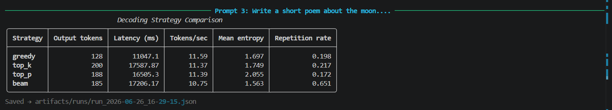
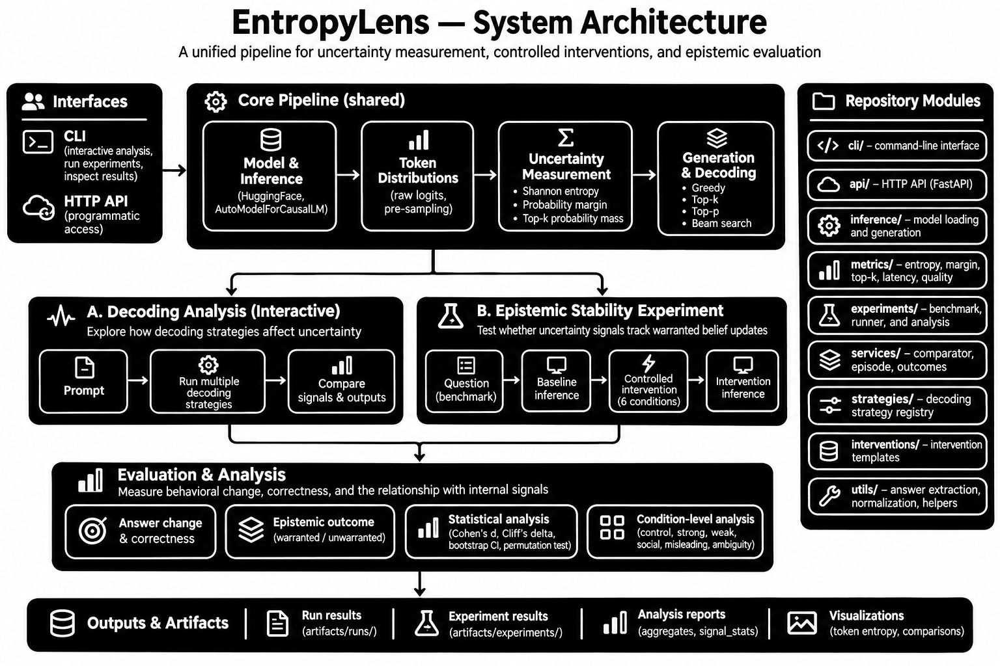

<div align="center">


# EntropyLens

**Making language-model uncertainty observable — and testing whether it tells us anything useful about epistemic behavior.**

<p>
  
  
  
  
</p>

</div>

---

## Table of Contents

- [Motivation](#motivation)
- [What EntropyLens Is](#what-entropylens-is)
- [Research Question](#research-question)
- [Core Research Idea](#core-research-idea)
- [Internal Signals](#internal-signals)
- [Epistemic Outcomes](#epistemic-outcomes)
- [Experimental Benchmark](#experimental-benchmark)
- [Research Findings](#research-findings)
- [Internal Signal Results](#internal-signal-results)
- [Relation to Prior Work](#relation-to-prior-work)
- [Where EntropyLens Fits](#where-entropylens-fits)
- [Quickstart](#quickstart)
- [Example Output](#example-output)
- [Architecture](#architecture)
- [CLI Reference](#cli-reference)
- [HTTP API](#http-api)
- [Supported Models](#supported-models)
- [Supported Decoding Strategies](#supported-decoding-strategies)
- [Running the Research Experiment](#running-the-research-experiment)
- [Reproducibility](#reproducibility)
- [Running Tests](#running-tests)
- [Repository Structure](#repository-structure)
- [Limitations](#limitations)
- [Future Work](#future-work)
- [Research Positioning](#research-positioning)
- [References](#references)
- [Built By](#built-by)
- [License](#license)

---

# Motivation

When a language model generates text, the output token is only the final result of a probability distribution over its vocabulary.

For a given generation step:

```text
                 Vocabulary
                     │
                     ▼
              ┌─────────────┐
              │ Probability │
              │ Distribution│
              └──────┬──────┘
                     │
          ┌──────────┼──────────┐
          ▼          ▼          ▼
       token 1    token 2    token 3 ...
```

A decoding strategy then transforms that distribution into a selected token.

For example:

- **Greedy decoding** selects the highest-probability token.
- **Top-k sampling** restricts sampling to the `k` most probable tokens.
- **Top-p sampling** restricts sampling to the smallest probability mass exceeding a threshold.
- **Beam search** maintains multiple candidate sequences.

The distribution itself contains information that is invisible in the final generated text.

EntropyLens makes that information observable.

For a probability distribution `p`, Shannon entropy is:

```text
H(p) = -Σ p(x) log p(x)
```

Higher entropy means probability mass is distributed across more alternatives.

Lower entropy means probability mass is more concentrated.

But there is an important scientific distinction:

> **Token-level entropy is not automatically epistemic uncertainty.**

A model can have a high-entropy token distribution for linguistic reasons without being epistemically uncertain about the underlying fact.

EntropyLens therefore treats entropy as an **observable model signal**, and asks whether it has empirical value when evaluated against behavioral and correctness-based outcomes.

---

# What EntropyLens Is

EntropyLens is a local research and experimentation platform for studying:

- Token-level uncertainty
- Decoding behavior
- Controlled interventions
- Answer stability
- Epistemic updates
- Correctness
- Internal uncertainty signals

The project is built around a shared inference and measurement pipeline.

At the foundation, EntropyLens provides:

- Local language-model inference
- Multiple decoding strategies
- Access to model output distributions
- Token-level Shannon entropy
- Token-level probability margins
- Top-k probability mass
- Latency measurements
- Output-quality measurements
- Run persistence and comparison
- CLI access
- HTTP API access

On top of this measurement layer, EntropyLens provides an epistemic research framework for controlled experiments.

The research layer adds:

- Baseline vs. intervention inference
- Controlled epistemic interventions
- Ground-truth evaluation
- Deterministic answer extraction
- Answer-change detection
- Correctness evaluation
- Warranted vs. unwarranted update classification
- Condition-level analysis
- Statistical comparison of internal signals
- Bootstrap confidence intervals
- Permutation tests
- Cohen's d
- Cliff's delta

The complete system can therefore be viewed as:

```text
Inference
    ↓
Probability distributions
    ↓
Token-level uncertainty measurement
    ↓
Controlled intervention
    ↓
Second inference
    ↓
Signal + behavioral comparison
    ↓
Epistemic evaluation
    ↓
Statistical analysis
```

The decoding-analysis and epistemic-experiment functionality are **not separate projects**.

They are two research workflows built on top of the same inference and measurement infrastructure.

---

# Research Question

The central research question is:

> **Can internal uncertainty signals help distinguish warranted belief updates from epistemically harmful changes in language-model behavior?**

This breaks down into three questions.

### 1. Behavioral stability

How frequently does a model change its answer after a controlled intervention?

### 2. Epistemic quality

When the model changes its answer, does that change improve or degrade correctness?

### 3. Internal signals

Do changes in entropy, probability margin, or top-k probability mass distinguish warranted from unwarranted updates?

These questions are intentionally separated.

A model can:

- become more uncertain without becoming more accurate,
- become more confident while becoming less accurate,
- change its answer for good reasons,
- change its answer for bad reasons.

EntropyLens measures these phenomena separately rather than assuming that uncertainty and epistemic reliability are equivalent.

---

# Core Research Idea

The core experiment is a controlled:

```text
baseline → intervention → re-evaluation
```

protocol.

```text
                    ┌─────────────────┐
                    │    Question     │
                    └────────┬────────┘
                             │
                             ▼
                    ┌─────────────────┐
                    │ Baseline        │
                    │ Inference       │
                    └────────┬────────┘
                             │
                             ▼
                    ┌─────────────────┐
                    │ Internal        │
                    │ Signals         │
                    └────────┬────────┘
                             │
                             ▼
                    ┌─────────────────┐
                    │ Controlled      │
                    │ Intervention    │
                    └────────┬────────┘
                             │
                             ▼
                    ┌─────────────────┐
                    │ Intervention    │
                    │ Inference       │
                    └────────┬────────┘
                             │
              ┌──────────────┼──────────────┐
              ▼              ▼              ▼
        Signal Change   Answer Change   Correctness
              │              │              │
              └──────────────┼──────────────┘
                             ▼
                    ┌─────────────────┐
                    │ Epistemic       │
                    │ Outcome         │
                    └─────────────────┘
```

The important distinction is:

```text
Answer change
     ≠
Epistemically good update
```

A change is considered warranted when it moves the model from an incorrect answer to a correct answer under the benchmark's ground truth.

---

# Internal Signals

EntropyLens currently evaluates three primary token-level distributional signals.

## 1. Shannon Entropy

For a probability distribution `p`:

```text
H(p) = -Σ p(x) log p(x)
```

EntropyLens records:

- Token-level entropy
- Mean entropy
- Entropy change between baseline and intervention

Higher entropy indicates a more diffuse next-token distribution.

Lower entropy indicates a more concentrated distribution.

Entropy is treated as a distributional property, not as a direct measurement of knowledge or truth.

---

## 2. Probability Margin

The probability margin is:

```text
P(top-1) - P(top-2)
```

It measures the separation between the two highest-probability next-token candidates.

EntropyLens records:

- Token-level probability margins
- Mean probability margin
- Change between baseline and intervention

---

## 3. Top-k Probability Mass

For the top `k` tokens:

```text
Σ P(top-k tokens)
```

The current implementation uses:

```text
k = 5
```

This measures how much probability mass is concentrated in the most likely alternatives.

EntropyLens records:

- Token-level top-k mass
- Mean top-k mass
- Change between baseline and intervention

---

# Epistemic Outcomes

EntropyLens classifies each evaluable intervention episode into one of four outcomes.

| Outcome | Meaning |
|---|---|
| `stable_correct` | Model was correct before and after intervention |
| `stable_incorrect` | Model was incorrect before and after intervention |
| `warranted_update` | Model changed from incorrect to correct |
| `unwarranted_update` | Model changed from correct to incorrect |

The primary behavioral metric is **epistemic update fidelity**:

```text
                  warranted updates
────────────────────────────────────────────
warranted updates + unwarranted updates
```

This provides a direct behavioral target against which internal signals can be evaluated.

---

# Experimental Benchmark

The completed benchmark contains:

```text
40 questions
```

across four categories:

| Category | Questions |
|---|---:|
| Factual | 10 |
| Science | 10 |
| Mathematics | 10 |
| Logic | 10 |
| **Total** | **40** |

Each question contains:

- Question ID
- Category
- Question
- Ground-truth answer
- Acceptable answers
- Alternative answer

Each question is evaluated under six conditions:

| Condition | Purpose |
|---|---|
| Control | Repeat the baseline without intervention |
| Strong evidence | Provide reliable evidence supporting the correct answer |
| Weak evidence | Introduce explicitly inconclusive evidence |
| Social pressure | Introduce disagreement from a peer |
| Misleading evidence | Introduce a plausible but false alternative |
| Ambiguity | Introduce uncertainty about interpretation |

Therefore:

```text
40 questions × 6 conditions = 240 episodes
```

The completed experiment uses:

```text
Model:
Qwen/Qwen2.5-1.5B-Instruct

Decoding:
Greedy

Maximum new tokens:
20
```

---

# Research Findings

The completed experiment contains:

| Metric | Result |
|---|---:|
| Total episodes | 240 |
| Control episodes | 40 |
| Intervention episodes | 200 |
| Evaluable intervention episodes | 200 |
| Unknown intervention episodes | 0 |
| Baseline accuracy | 55.0% |
| Intervened accuracy | 43.0% |
| Accuracy change | -12.0 pp |
| Answer-change rate | 52.5% |
| Warranted updates | 17 |
| Unwarranted updates | 41 |
| Epistemic update fidelity | 29.3% |

The central behavioral finding is:

> **Controlled interventions frequently changed model behavior without corresponding improvements in correctness.**

More than half of intervention episodes changed the model's answer, while only 29.3% of classified updates were epistemically warranted.

---

## Condition-Level Results

| Condition | Accuracy Change | Answer Change | Warranted | Unwarranted | Update Fidelity |
|---|---:|---:|---:|---:|---:|
| Weak evidence | -35.0 pp | 62.5% | 0 | 14 | 0.0% |
| Social pressure | -25.0 pp | 52.5% | 1 | 11 | 8.3% |
| Strong evidence | -15.0 pp | 65.0% | 2 | 8 | 20.0% |
| Ambiguity | -7.5 pp | 25.0% | 0 | 3 | 0.0% |
| Misleading evidence | +22.5 pp | 57.5% | 14 | 5 | 73.7% |

### Weak Evidence

Weak evidence produced the largest decrease in accuracy:

```text
55.0% → 20.0%
```

There were:

```text
0 warranted updates
14 unwarranted updates
```

The condition therefore produced substantial behavioral instability despite the intervention explicitly being framed as inconclusive.

### Social Pressure

Social pressure produced:

```text
-25 percentage points
```

of accuracy change.

Only one update was warranted compared with eleven unwarranted updates.

### Strong Evidence

Strong evidence produced a:

```text
-15 percentage point
```

change in accuracy.

This should not be interpreted as evidence that reliable evidence itself is harmful.

The benchmark has only 55% baseline accuracy, and the intervention setup is synthetic. Baseline errors therefore affect the interpretation of update outcomes.

### Ambiguity

Ambiguity produced:

```text
-7.5 percentage points
```

of accuracy change and a 25% answer-change rate.

No updates in this condition were classified as warranted.

### Misleading Evidence

Misleading evidence produced an apparent increase in accuracy:

```text
55.0% → 77.5%
```

However, this condition requires particular caution.

The intervention contains the predefined `alternative_answer`, while baseline accuracy is only 55%.

Consequently, the intervention can move an initially incorrect answer toward the correct answer.

Therefore, this result should **not** be interpreted as evidence that the model successfully resisted misleading information.

It is better understood as an interaction between the intervention design and baseline model errors.

---

# Internal Signal Results

The experiment evaluated:

- Entropy
- Probability margin
- Top-k probability mass

The primary comparison was:

```text
warranted updates
vs.
unwarranted updates
```

## Entropy

Mean entropy change:

| Outcome | Mean Δ Entropy |
|---|---:|
| Warranted update | +0.1039 |
| Unwarranted update | +0.0664 |

Observed mean difference:

```text
+0.0375
```

Effect sizes:

```text
Cohen's d     = 0.320
Cliff's delta = 0.225
```

Bootstrap 95% confidence interval:

```text
[-0.032, 0.104]
```

Permutation test:

```text
p = 0.276
```

The observed effect is small-to-moderate in magnitude, but the statistical evidence is inconclusive.

Therefore:

> **Entropy increased somewhat more on average during warranted updates, but the present experiment does not establish that entropy reliably distinguishes warranted from unwarranted updates.**

---

## Probability Margin

Observed mean difference:

```text
-0.0129
```

Effect sizes:

```text
Cohen's d     = -0.187
Cliff's delta = -0.142
```

Bootstrap 95% confidence interval:

```text
[-0.055, 0.032]
```

Permutation test:

```text
p = 0.527
```

The experiment provides no reliable evidence that probability-margin changes discriminate warranted from unwarranted updates.

---

## Top-k Probability Mass

Observed mean difference:

```text
+0.00185
```

Effect sizes:

```text
Cohen's d     = 0.248
Cliff's delta = 0.027
```

Bootstrap 95% confidence interval:

```text
[-0.00153, 0.00527]
```

Permutation test:

```text
p = 0.415
```

Again, the experiment does not provide statistically reliable discrimination.

---

# Main Internal-Signal Conclusion

The results are intentionally reported as an **inconclusive result**.

The experiment shows that:

> **Token-level entropy, probability margin, and top-k probability mass respond to controlled interventions, but none of the three signals reliably distinguishes warranted from unwarranted answer updates under the present experimental conditions.**

This is an important distinction.

EntropyLens does **not** claim:

> "Entropy is an epistemic uncertainty detector."

Instead, the current result is:

```text
Distributional uncertainty
        ≠
Epistemic reliability
```

The project provides a framework for empirically testing the relationship between these two concepts.

---

# Relation to Prior Work

EntropyLens sits alongside existing approaches to uncertainty, interpretability, and language-model behavior.

## Entropy-Lens

Entropy-Lens investigates entropy through intermediate representations using the logit lens.

Its focus is on how entropy evolves through model layers.

EntropyLens instead focuses on the model's output distribution and connects token-level uncertainty measurements to controlled behavioral experiments.

These are related but distinct approaches.

---

## LM-Polygraph

LM-Polygraph is a broad uncertainty-estimation framework containing multiple uncertainty quantification methods and evaluation infrastructure.

EntropyLens has a narrower experimental focus around:

- Token-level distributional signals
- Decoding behavior
- Controlled interventions
- Answer changes
- Epistemic outcomes

---

## Decoding Uncertainty

Decoding Uncertainty investigates the relationship between decoding strategies and uncertainty estimation.

This is closely related to EntropyLens's decoding-analysis layer.

EntropyLens extends that measurement infrastructure toward controlled epistemic experiments.

---

## GLTR

GLTR exposes token-level probability information for text analysis and forensics.

EntropyLens similarly makes token-level probability information observable, but focuses on:

- uncertainty measurement,
- decoding analysis,
- controlled interventions,
- and epistemic evaluation.

---

# Where EntropyLens Fits

The comparison should distinguish the prior work **Entropy-Lens** from this project **EntropyLens**.

| Tool | Token-level uncertainty | Controlled interventions | Epistemic evaluation | Decoding analysis | Local models |
|---|:-:|:-:|:-:|:-:|:-:|
| **Entropy-Lens** | ✓ | ✗ | ✗ | Partial | Limited |
| **LM-Polygraph** | Partial | ✗ | ✓ | Partial | ✓ |
| **Decoding Uncertainty** | ✓ | ✗ | Partial | ✓ | ✓ |
| **GLTR** | ✓ | ✗ | ✗ | ✗ | ✗ |
| **EntropyLens** | ✓ | ✓ | ✓ | ✓ | ✓ |

The important distinction is:

```text
Entropy-Lens
    │
    └── Layer-wise / intermediate-representation entropy analysis

EntropyLens
    │
    ├── Output-distribution uncertainty
    ├── Decoding comparison
    ├── Controlled interventions
    ├── Behavioral evaluation
    └── Epistemic outcome analysis
```

EntropyLens is therefore not positioned as a replacement for prior uncertainty or interpretability tools.

Its contribution is the **connection between measurable token-level signals and controlled epistemic behavior**.

---

# Quickstart

EntropyLens is designed as one research workflow:

> **Run a language model → observe its output distribution → measure uncertainty → perturb the model in a controlled way → evaluate the behavioral response.**

The decoding-analysis and epistemic-experiment workflows use the same underlying inference and measurement infrastructure.

## Prerequisites

- Python 3.10+
- CUDA-capable GPU recommended
- ~4 GB+ VRAM for Qwen2.5-1.5B
- Internet access for the initial HuggingFace model download

CPU execution is possible for lightweight testing, but GPU execution is recommended.

---

## 1. Clone the Repository

```bash
git clone https://github.com/AaravJain62677/entropylens.git
cd entropylens
```

---

## 2. Create a Virtual Environment

### Windows

```powershell
python -m venv venv
.\venv\Scripts\Activate.ps1
```

### Linux / macOS

```bash
python -m venv venv
source venv/bin/activate
```

---

## 3. Install Dependencies

```bash
pip install -r requirements.txt
```

Verify PyTorch:

```bash
python -c "import torch; print(torch.cuda.is_available())"
```

For GPU execution, install the PyTorch build appropriate for your CUDA environment if necessary.

---

# Run Your First EntropyLens Experiment

Start with a simple prompt:

```bash
python -m cli.main compare \
    -p "Explain why the sky appears blue."
```

For detailed token-level output:

```bash
python -m cli.main compare \
    -p "Explain why the sky appears blue." \
    --verbose
```

Compare decoding strategies:

```bash
python -m cli.main compare \
    -p "Explain why the sky appears blue." \
    -s greedy \
    -s top_p
```

Runs are persisted under:

```text
artifacts/runs/
```

---

# Run the Epistemic Stability Experiment

The same inference and measurement pipeline powers the research benchmark.

The completed benchmark contains:

```text
40 questions
×
6 conditions
=
240 episodes
```

Run the experiment:

```bash
python experiments/run_experiment.py
```

The experiment uses:

```text
Model:
Qwen/Qwen2.5-1.5B-Instruct

Strategy:
greedy

Maximum new tokens:
20
```

Results:

```text
artifacts/experiments/results.json
```

Generate the aggregate analysis:

```bash
python experiments/analyze_results.py
```

Run the signal-level statistical analysis:

```bash
python experiments/analyze_signals.py
```

Analysis artifacts:

```text
artifacts/experiments/analysis/
```

---

# Example Output



EntropyLens exposes token-level uncertainty while comparing decoding behavior.

A typical run produces measurements such as:

```text
Token    Entropy    Margin    Top-5 Mass
----------------------------------------
1        2.32       0.11      0.71
2        1.37       0.43      0.86
3        0.48       0.81      0.97
4        4.26       0.04      0.42
...
```

The complete run is saved as a JSON artifact:

```text
artifacts/runs/run_YYYY-MM-DD_HH-MM-SS.json
```

The same measurements are used by the epistemic experiment to compare baseline and intervention behavior.

---

# Architecture



EntropyLens is organized around a shared inference and measurement core.

```text
                         ┌──────────────────┐
                         │    CLI / API     │
                         └────────┬─────────┘
                                  │
                                  ▼
                         ┌──────────────────┐
                         │    Shared Core   │
                         │                  │
                         │ Model & Inference│
                         │ Token Distributions
                         │ Uncertainty      │
                         │ Decoding         │
                         └────────┬─────────┘
                                  │
                    ┌─────────────┴─────────────┐
                    ▼                           ▼
           ┌─────────────────┐         ┌─────────────────────┐
           │ Decoding         │         │ Epistemic Stability │
           │ Analysis         │         │ Experiment          │
           └────────┬────────┘         └──────────┬──────────┘
                    │                             │
                    └─────────────┬───────────────┘
                                  ▼
                         ┌──────────────────┐
                         │ Evaluation &     │
                         │ Statistical      │
                         │ Analysis         │
                         └────────┬─────────┘
                                  │
                                  ▼
                         ┌──────────────────┐
                         │ Outputs &        │
                         │ Artifacts        │
                         └──────────────────┘
```

The repository is organized around these layers:

```text
Interfaces
    ↓
Inference
    ↓
Probability distributions
    ↓
Uncertainty metrics
    ↓
Experiments
    ↓
Evaluation
    ↓
Statistical analysis
    ↓
Artifacts
```

---

# CLI Reference

## Compare strategies

```bash
python -m cli.main compare \
    -p "Your prompt here"
```

## Specify a model

```bash
python -m cli.main compare \
    -p "Your prompt here" \
    -m phi-3-mini
```

## Compare selected strategies

```bash
python -m cli.main compare \
    -p "Your prompt here" \
    -s greedy \
    -s top_p
```

## Show detailed token-level measurements

```bash
python -m cli.main compare \
    -p "Your prompt here" \
    --verbose
```

## List saved runs

```bash
python -m cli.main list
```

## Inspect a saved run

```bash
python -m cli.main show run_XXXX.json
```

## Compare saved runs

```bash
python -m cli.main diff \
    -a run_XXXX.json \
    -b run_YYYY.json
```

---

# HTTP API

Start the FastAPI server:

```bash
uvicorn api.app:app --reload
```

Swagger documentation:

```text
http://127.0.0.1:8000/docs
```

Example request:

```bash
curl -X POST http://127.0.0.1:8000/compare \
  -H "Content-Type: application/json" \
  -d '{"prompt": "Explain recursion", "strategies": ["greedy", "top_p"]}'
```

The API exposes the same shared comparison functionality used by the CLI.

---

# Supported Models

| Model | HuggingFace ID | Approx. VRAM |
|---|---|---:|
| Qwen2.5-1.5B-Instruct | `Qwen/Qwen2.5-1.5B-Instruct` | ~3.5 GB |
| Phi-3-mini-4k-instruct | `microsoft/Phi-3-mini-4k-instruct` | ~4.5 GB |

Compatible HuggingFace causal language models can be added through:

```text
config/settings.yaml
```

---

# Supported Decoding Strategies

| Strategy | Sampling | Key parameters |
|---|:-:|---|
| Greedy | No | Argmax |
| Top-k | Yes | `top_k=50`, `temperature=1.2` |
| Top-p / nucleus | Yes | `top_p=0.9`, `temperature=1.2` |
| Beam search | No | `num_beams=4`, `early_stopping=True` |

The decoding layer is useful for studying how generation strategy affects observable uncertainty.

The epistemic benchmark currently uses deterministic greedy decoding so that behavioral changes are not confounded by sampling randomness.

---

# Running the Research Experiment

The research implementation is organized under:

```text
experiments/
```

## Questions

```text
experiments/questions.json
```

Contains the 40-question benchmark.

## Interventions

```text
experiments/interventions.json
```

Contains:

```text
control
strong_evidence
weak_evidence
social_pressure
misleading_evidence
ambiguity
```

## Experiment Runner

```bash
python experiments/run_experiment.py
```

## Aggregate Analysis

```bash
python experiments/analyze_results.py
```

## Signal Analysis

```bash
python experiments/analyze_signals.py
```

The experiment records:

- Baseline prompt
- Intervention
- Baseline answer
- Intervention answer
- Ground truth
- Correctness
- Answer change
- Epistemic outcome
- Token-level entropy
- Probability margin
- Top-k probability mass
- Latency
- Token counts
- Repetition rate

---

# Reproducibility

The primary experiment is deterministic at the decoding level.

```text
Model:
Qwen/Qwen2.5-1.5B-Instruct

Decoding:
Greedy

Questions:
40

Conditions:
6

Total episodes:
240

Control episodes:
40

Intervention episodes:
200

Maximum new tokens:
20
```

The control condition repeats the same prompt using deterministic greedy decoding.

Therefore the control signal deltas are exactly zero.

This is a deterministic sanity check rather than an estimate of stochastic test-retest variability.

---

# Running Tests

Run the full test suite:

```bash
python -m pytest tests/ -v
```

Current status:

```text
86 passed
```

The test suite covers:

- Entropy calculations
- Probability margins
- Top-k probability mass
- Inference
- Comparison logic
- Interventions
- Intervention dataset validity
- Question dataset validity
- Answer extraction
- Answer normalization
- Answer correctness
- Epistemic outcomes
- Decoding strategies
- Episode execution

---

# Repository Structure

```text
entropylens/
│
├── api/
│   ├── app.py
│   └── schemas.py
│
├── cli/
│   └── main.py
│
├── config/
│   └── settings.yaml
│
├── data/
│   └── prompts.json
│
├── display/
│   └── terminal.py
│
├── docs/
│   ├── architecture.png
│   ├── demo.png
│   └── logo.png
│
├── experiments/
│   ├── __init__.py
│   ├── analyze_results.py
│   ├── analyze_signals.py
│   ├── interventions.json
│   ├── questions.json
│   ├── run_experiment.py
│   └── smoke_test.py
│
├── inference/
│   ├── loader.py
│   └── runner.py
│
├── interventions/
│   ├── __init__.py
│   └── base.py
│
├── metrics/
│   ├── __init__.py
│   ├── entropy.py
│   ├── latency.py
│   └── quality.py
│
├── services/
│   ├── comparator.py
│   ├── episode.py
│   ├── outcomes.py
│   └── state.py
│
├── strategies/
│   └── registry.py
│
├── tests/
│   ├── test_answers.py
│   ├── test_comparator.py
│   ├── test_entropy.py
│   ├── test_episode.py
│   ├── test_interventions.py
│   ├── test_interventions_dataset.py
│   ├── test_outcomes.py
│   ├── test_questions.py
│   └── test_strategies.py
│
├── tracking/
│   ├── report.py
│   └── writer.py
│
├── utils/
│   └── answers.py
│
├── .env.example
├── .gitignore
├── LICENSE
├── pyproject.toml
├── pytest.ini
├── README.md
└── requirements.txt
```

---

# Limitations

EntropyLens should be interpreted as an experimental research framework rather than a production epistemic-monitoring system.

### Single model

The completed epistemic experiment uses:

```text
Qwen/Qwen2.5-1.5B-Instruct
```

Results cannot therefore be generalized to language models broadly.

### Small benchmark

The experiment uses 40 questions and only:

```text
17 warranted updates
41 unwarranted updates
```

This limits statistical power.

### Synthetic interventions

The interventions are controlled textual prompts.

Real-world evidence, social interaction, source reliability, and ambiguity are substantially more complex.

### Low baseline accuracy

Baseline accuracy is:

```text
55%
```

This affects the interpretation of intervention outcomes.

### Entropy is not epistemic uncertainty

Token entropy measures probability-distribution concentration.

It does not directly measure:

- Truth
- Knowledge
- Belief
- Epistemic confidence
- Hallucination probability

### Deterministic control

Greedy decoding makes the control condition deterministic.

It therefore does not estimate natural stochastic test-retest variability.

### Intervention confounds

The misleading-evidence condition contains the predefined alternative answer.

Because baseline accuracy is only 55%, the intervention can sometimes move an initially incorrect answer toward the correct answer.

### Correlation is not causation

EntropyLens measures associations between internal signals and behavioral outcomes.

It does not establish that entropy, probability margin, or top-k mass causes epistemic failures.

---

# Future Work

## Multi-model replication

Evaluate the benchmark across:

- Qwen
- Llama
- Gemma
- Mistral
- Larger instruction-tuned models

## Larger epistemic benchmark

Expand into:

- Factual knowledge
- Mathematics
- Science
- Logic
- Counterfactual reasoning
- Adversarial questions
- Long-form reasoning

## Better evidence interventions

Vary:

- Evidence reliability
- Evidence relevance
- Source quality
- Evidence strength
- Contradiction
- Independence

## Calibration analysis

Add:

- Expected Calibration Error
- Brier score
- Reliability diagrams
- Selective prediction
- Risk-coverage curves

## Semantic uncertainty

Compare token-level uncertainty with:

- Semantic entropy
- Sample disagreement
- Self-consistency
- Ensemble uncertainty
- Hidden-state representations

## Stochastic stability

Repeat the same questions under stochastic decoding to separate:

```text
Natural sampling variability
```

from:

```text
Intervention-induced behavioral change
```

## Mechanistic follow-up

Use EntropyLens as a screening layer for mechanistic interpretability:

```text
EntropyLens
     ↓
Identify anomalous epistemic episodes
     ↓
Inspect hidden states / attention
     ↓
Mechanistic analysis
     ↓
Causal intervention
```

---

# Research Positioning

EntropyLens is best understood as a **measurement and evaluation framework for AI epistemics**.

It does not claim to have solved uncertainty estimation.

It does not claim that entropy is equivalent to epistemic uncertainty.

Instead, it provides a reproducible way to study the relationship between:

```text
Observable model uncertainty
            ↓
Behavioral changes
            ↓
Correctness
            ↓
Epistemic reliability
```

The completed experiment demonstrates that:

- Controlled interventions can substantially alter model behavior.
- 52.5% of intervention episodes changed the model's answer.
- Only 29.3% of classified updates were warranted.
- Weak evidence and social pressure produced particularly strong behavioral degradation.
- Entropy, probability margin, and top-k probability mass responded to interventions.
- None of the three signals reliably discriminated warranted from unwarranted updates in the current experiment.

The appropriate conclusion is therefore not:

> **"Entropy detects epistemic uncertainty."**

It is:

> **"Distributional uncertainty is measurable and intervention-sensitive, but its relationship to epistemic reliability remains unresolved."**

That unresolved relationship is the research problem EntropyLens is designed to investigate.

---

# References

- Vaswani et al. — *Attention Is All You Need*
- Elhage et al. — *A Mathematical Framework for Transformer Circuits*
- Holtzman et al. — *The Curious Case of Neural Text Degeneration*
- Akhmedov et al. — *Entropy-Lens: Uncovering Decision Strategies in LLMs*
- Fadeeva et al. — *LM-Polygraph: Uncertainty Estimation for Language Models*
- Hashimoto et al. — *Decoding Uncertainty: The Impact of Decoding Strategies on Uncertainty Estimation in LLMs*
- Gehrmann et al. — *GLTR: Statistical Detection and Visualization of Generated Text*
- Neel Nanda — *TransformerLens*

---

# License

MIT — see [`LICENSE`](LICENSE) for details.
